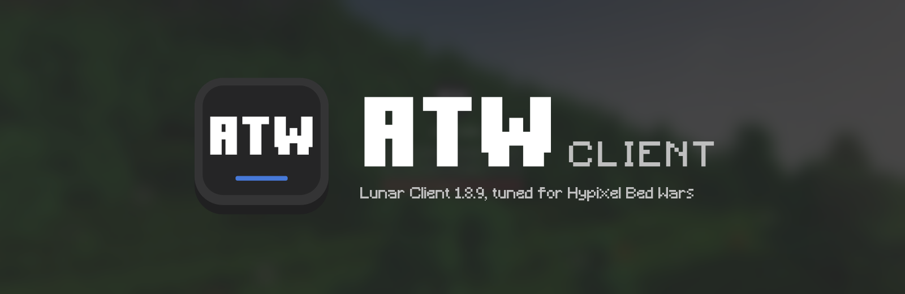
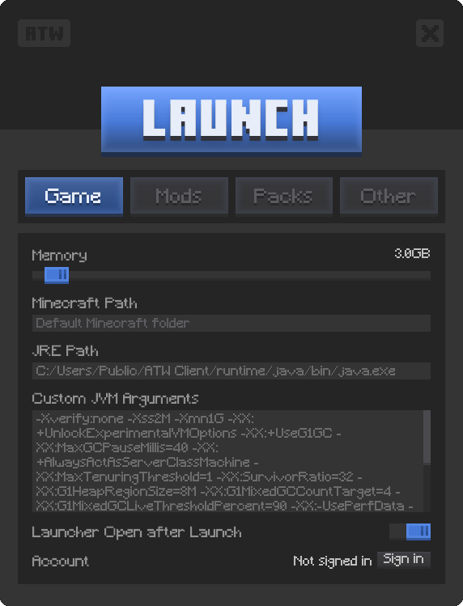
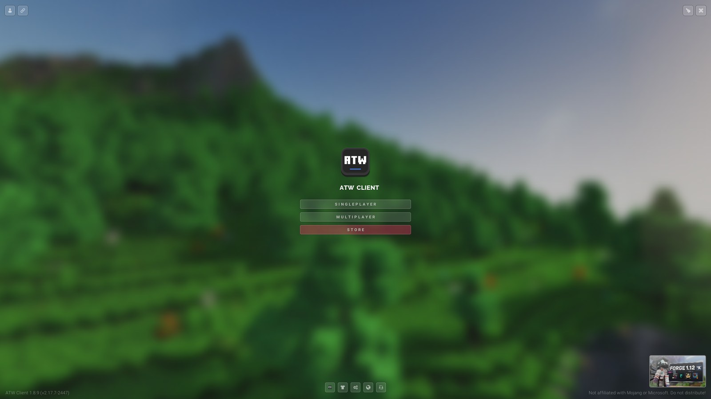
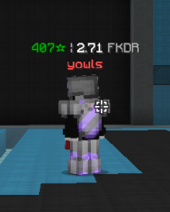
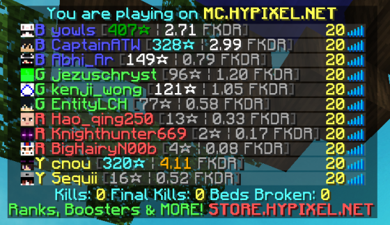

<p align="center">
  
</p>

<p align="center">
  
  
  
  
  
</p>

ATW Client is a Qt/C++ launcher and a set of Weave mods for Lunar Client on
Minecraft 1.8.9, built around Hypixel Bed Wars. It started from
[Youded-byte/lunar-client-qt](https://github.com/Youded-byte/lunar-client-qt)
and runs on Java 17 with Weave 1.4.1.

- `atw-launch.exe` signs in with Microsoft and starts the game.
- `atw-config.exe` edits settings and manages the saved account.

## Screenshots

<table>
  <tr>
    <td width="36%" align="center"></td>
    <td width="64%" align="center"></td>
  </tr>
  <tr>
    <td align="center"><sub>The launcher (<code>atw-config</code>)</sub></td>
    <td align="center"><sub>The in-game main menu</sub></td>
  </tr>
  <tr>
    <td align="center"></td>
    <td align="center"></td>
  </tr>
  <tr>
    <td align="center"><sub>LevelHead above a player</sub></td>
    <td align="center"><sub>LevelHead Bed Wars stats in the tab list</sub></td>
  </tr>
</table>

## What's in the package

| Mod | What it does |
| --- | --- |
| [LevelHead](weave-mods/atw-levelhead/README.md) | Shows Hypixel network level, or Bed Wars stars and FKDR during Bed Wars games, above heads and in the tab list |
| [ATW's Overlay](weave-mods/optimal-zone/README.md) | Client-side visual overlays: closest-hitbox marker, bow and pearl trajectory, minimap, player and invisible-player highlights |
| [RawInput](weave-mods/raw-input/README.md) | Raw mouse input on Windows; a Weave 1.4.1 reconstruction of koxx12dev's RawInput 1.0.1 |
| NoHitDelay | Removes the 10-tick delay after a missed click |
| [Render Boost](weave-mods/atw-render-boost/README.md) | Name parse cache (on by default), a frame benchmark, and optional experiments that stay off |
| [Rebrand](weave-mods/atw-rebrand/README.md) | Puts the ATW logo in the game menus without touching your resource packs |
| [Dispatch](weave-mods/atw-event-dispatch/README.md) | Optional event-dispatch experiment; off and not in the default build |

Measured gains so far, each from its own test and not additive:

- The name parse cache raised average FPS from 473 to 532 (+12.6%) in moving
  Bed Wars Practice tests at windowed 2560x1421.
  [Evidence and limits](docs/NAME_PARSE_PERFORMANCE.md).
- OptiFine Render Regions, kept on for the tested profile, raised FPS from 626
  to 1,017 (+62.5%) in two warmed terrain runs.
  [Qualification](docs/RENDER_REGIONS_QUALIFICATION.md).

The [performance status](ATW_RENDER_BOOST.md) lists what is shipped, what is
still experimental, and what hasn't shown a gain.

## Download

**Windows.** [Download the portable package](https://github.com/alextyhwang/ATW-Client-Portable/releases/latest)
while signed in to a GitHub account that can see that private repository.
Extract the ZIP and run `Start ATW.cmd`. The [portable guide](docs/PORTABLE.md)
covers setup, account storage, packaging and diagnostics.

**Mac (Apple silicon).** The shared `main` branch also builds a Mac package
with bundled Java, Qt, pinned Lunar and Weave, and the current portable
configuration. It uses OpenGL and keeps experimental Mac input continuity off.
[Mac download and test status](docs/MAC_TEST_READY.md) has the install steps
and what has been tested.

## Status

The 2026-11-02 tests passed sign-in, account retention, relaunch and Bed Wars
Practice joins, with both normal and fresh settings. Hypixel still disconnects
on BLACKBOX; it joined on Alayna's PC on the same network.
[Portability status](PORTABILITY_TODO.md) lists the remaining checks, and the
[documentation map](docs/README.md) points to task-specific guides and the
dated test evidence.

## Build

You need Windows, CMake 3.21+, a C++17 toolchain that works with Qt 5 or 6, Qt
Core/Gui/Widgets/Svg/Network, and a Java 17 JDK. The public source doesn't
include the private Lunar/Minecraft payload, so packaging needs a working local
installation.

From the repository root in PowerShell 7:

```powershell
./scripts/fetch_weave_runtime.ps1
./scripts/build_mods.ps1
cmake -S . -B cmake-build-weave141 -DCMAKE_BUILD_TYPE=Release
cmake --build cmake-build-weave141 --config Release
```

Add your own Qt and compiler generator options when configuring a fresh tree.

- Branding preparation also needs Python 3 with Pillow. See
  [docs/BRANDING.md](docs/BRANDING.md) for the native icon and game-resource
  workflow.
- `build_mods.ps1` builds and tests the canonical sources but doesn't install
  them. Follow [MODS.md](MODS.md) to install verified modules before packaging.
  LevelHead's label-cache source in particular is not the retained runtime
  baseline.
- `cmake-build-weave141` is this checkout's CMake tree. `build/` is the private
  runtime package, not a reusable CMake tree. Avoid relocated CMake caches.
- CMake deploys Qt on Windows. To refresh the existing package, close the game
  and launchers, back up its two executables, then copy verified replacements
  from the CMake tree. Keep the package's data, settings and accounts.
- The legacy `atw-client` and `atw-test-exe` targets need
  `-DATW_BUILD_LEGACY_TARGETS=ON` and don't ship by default. The legacy
  test-bundle script is not the portable release workflow.

## Repository layout

| Path | Purpose |
| --- | --- |
| `src/config`, `src/launch`, `src/auth`, `src/core` | Settings, launch, sign-in and shared native logic |
| `src/gui`, `res` | Configuration UI and shipped resources |
| `weave-mods` | Canonical mod sources and tests; see [MODS.md](MODS.md) |
| `java` | Agent and helper sources, supporting libraries |
| `scripts` | Runtime fetch, mod build, packaging and release tooling |
| `branding` | Brand kit: logos, colours, type, screenshots, banners ([guide](branding/README.md)) |
| `docs` | Current guides plus dated research and qualification evidence |
| `runtime`, `data`, `build`, `releases`, `upgrade-work` | Ignored local payloads, outputs and experiments |

## Settings and tests

Package settings live in `config/settings.json` next to the executables.
`src/config/config.h` and `src/config/config.cpp` define the schema and
defaults. Edit settings with `atw-config.exe`; saved settings override source
defaults. Java's private home is `data/home`, and the portable guide documents
the other package paths. The legacy `autoLaunchOnOpen` setting and `--gui`
flag don't affect `atw-launch`.

For authentication and packaging regressions, use Windows PowerShell 5.1:

```powershell
powershell.exe -NoProfile -ExecutionPolicy Bypass -File scripts/tests/test_verify_portable_bundle.ps1
powershell.exe -NoProfile -ExecutionPolicy Bypass -File scripts/tests/test_lunar_account_contract.ps1
```

Mod builds run each module's tests. Live rendering or input changes also need
the relevant qualification checks; a successful compile doesn't show a
performance gain.

## Distribution

Commit source, tests and redacted evidence. Keep tokens, account files, API
keys, private runtime settings and generated payloads out of git. Packages
contain Lunar and Minecraft files, so they are only distributed through the
private release repository. [docs/PORTABLE.md](docs/PORTABLE.md) describes the
account-free build and publish workflow.

## Credits

Built on the [Lunar Client Qt](https://github.com/Youded-byte/lunar-client-qt)
launcher and [Java-Optimisations-MC](https://github.com/Youded-byte/Java-Optimisations-MC).
NoHitDelay is by nilsen84.

Licensed under the [GNU GPL v3](LICENSE). ATW Client is an independent project
and is not affiliated with Mojang, Microsoft or Lunar Client.
