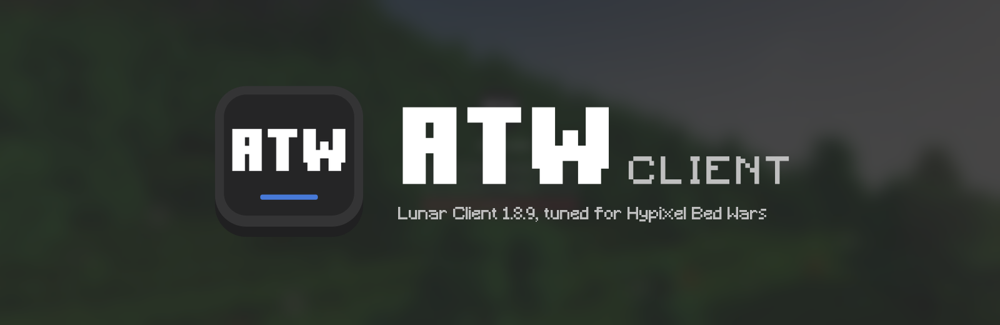
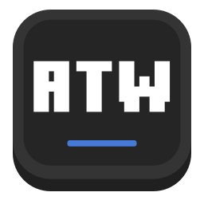
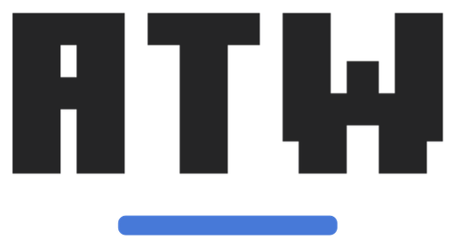
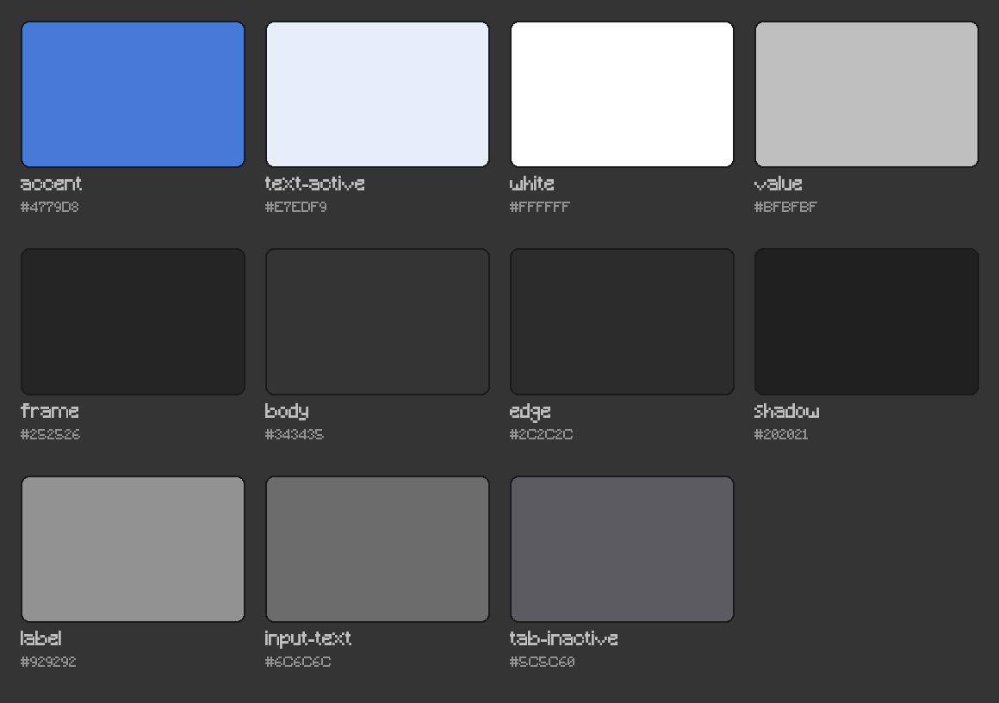

# ATW Client brand kit

This folder holds the ATW Client logo, colours, type, screenshots and banners
in formats designers and agents can use directly. The shipped app icons and
in-game textures live elsewhere (see [Where the brand ships](#where-the-brand-ships));
this kit is the reference and the place to start new design work.



## Contents

| Path | What it is |
| --- | --- |
| [`logo/atw-icon.svg`](logo/atw-icon.svg) | App icon: dark raised tile, ATW lettering, blue bar. Master artwork. |
| [`logo/png/atw-icon-*.png`](logo/png/) | App icon at 16, 32, 64, 128, 256, 512 and 1024 px |
| [`logo/atw-mark-light.svg`](logo/atw-mark-light.svg), [`-dark`](logo/atw-mark-dark.svg) | Lettermark without the tile: ATW over the blue bar |
| [`logo/atw-wordmark-light.svg`](logo/atw-wordmark-light.svg), [`-dark`](logo/atw-wordmark-dark.svg) | ATW CLIENT on one line |
| [`logo/png/`](logo/png/) | PNG exports of the mark (512 px) and wordmark (1200 px) |
| [`colors/palette.json`](colors/palette.json), [`palette.png`](colors/palette.png) | Colour tokens with hex values and uses |
| [`banners/readme-banner.png`](banners/readme-banner.png) | 1600 x 520 header for the GitHub README |
| [`banners/social-preview.png`](banners/social-preview.png) | 1280 x 640 GitHub social preview (Settings > Social preview) |
| [`screenshots/`](screenshots/) | Real captures of the launcher and game, cleared for public use |
| [`tools/build_kit.py`](tools/build_kit.py) | Rebuilds every logo, banner and palette file in this folder |

"Light" artwork is white and goes on dark backgrounds. "Dark" artwork is
near-black (`frame`) and goes on light backgrounds.

## Name

The product is **ATW Client**. Write ATW in capitals. The game window title is
`ATW Client 1.8.9`; the Windows executables describe themselves as ATW Client
Launcher, ATW Client Settings and ATW Client. In-game menus show `ATW CLIENT`
and `ATW Options...`.

## Logo

<p>
  
  &nbsp;&nbsp;
  <picture>
    <source media="(prefers-color-scheme: dark)" srcset="logo/png/atw-mark-light-512.png">
    
  </picture>
</p>

The icon is a 1024-unit square built from four layers, back to front:

1. Base tile, `shadow` `#202021`, offset down to read as the tile's thickness.
2. Rim, `body` `#343435`, radius 190.
3. Inner face, `frame` `#252526`, radius 138.
4. White ATW lettering and the `accent` `#4779D8` bar (348 x 31, radius 12).

The ATW letters are outlined paths from the Figma launcher design, the same
display face as the LAUNCH button. They are not set from a font file, so copy
the paths in [`res/ui/window/label-atw.svg`](../res/ui/window/label-atw.svg)
rather than retyping the letters.

Rules for the current logo:

- Use the full icon for app icons, favicons and avatars. Use the lettermark or
  wordmark when the tile would sit inside another rounded container.
- Keep the blue bar. It is the only colour in the logo.
- Keep clear space of at least the bar's height around the mark, and half the
  ATW letter height around the wordmark.
- Scale proportionally. Don't stretch, rotate, outline, or add gradients or
  glows to the lettering.
- The icon ships down to 16 px (Windows ICO, Lunar's smallest logo texture).
  Check any change at that size; CLIENT in the wordmark gets thin first.

## Colour

The palette is the launcher's own theme (`AtwTheme::Color` in
`src/gui/style/atwtheme.*`, documented in [UI design](../docs/UI_DESIGN.md)).
The look is a dark, slightly warm grey with one blue accent.



| Token | Hex | Use |
| --- | --- | --- |
| `accent` | `#4779D8` | Logo bar, LAUNCH button, active tab, toggles |
| `text-active` | `#E7EDF9` | Text on accent surfaces |
| `white` | `#FFFFFF` | ATW lettering on dark surfaces |
| `value` | `#BFBFBF` | Values, secondary text, CLIENT in the light wordmark |
| `frame` | `#252526` | Window header, cards, icon face, banner background |
| `body` | `#343435` | Window body, inputs, icon rim |
| `edge` | `#2C2C2C` | Hard edge under raised surfaces |
| `shadow` | `#202021` | Icon base tile |
| `label` | `#929292` | Field labels |
| `input-text` | `#6C6C6C` | Placeholder and input text |
| `tab-inactive` | `#5C5C60` | Inactive tabs, CLIENT in the dark wordmark |

[`colors/palette.json`](colors/palette.json) is the machine-readable copy. If
you change a value there, change `AtwTheme::Color` and `docs/UI_DESIGN.md` too.

## Type

| Role | Face | Source |
| --- | --- | --- |
| ATW lettering, LAUNCH, CLOSE | Minecraft Ten (Figma display face) | Outlined paths in `res/ui/window` and `res/ui/launch-button`. The font itself is not bundled. |
| UI text, CLIENT, taglines | Minecraft (pixel face, weight 500 in the UI) | [`res/fonts/Minecraft.ttf`](../res/fonts/Minecraft.ttf) |

Use these two faces only. Set anything that must look exact (logos, big
labels) as outlined paths so it renders the same on machines without the font.

## Look and feel

The launcher draws raised, chunky surfaces: a flat face, a soft inner glow and
a hard darker edge underneath, like a Minecraft button seen in 3D. Corners are
rounded (10 px on the window, 190/1024 on the icon). Text is grey on grey,
with white and blue reserved for what matters. New artwork should feel like it
belongs next to the [launcher screenshot](screenshots/launcher.png).

## Screenshots

| File | Shows |
| --- | --- |
| [`launcher.png`](screenshots/launcher.png) | `atw-config` Game tab, 572 x 749, transparent rounded corners |
| [`main-menu.jpg`](screenshots/main-menu.jpg) | In-game main menu with the ATW logo, 1600 px wide |
| [`bedwars-tab.png`](screenshots/bedwars-tab.png) | LevelHead Bed Wars stars and FKDR in the tab list |
| [`above-head-tag.png`](screenshots/above-head-tag.png) | LevelHead tag above a player |

To add screenshots:

- Capture the launcher from a scratch copy of the binaries with no
  `config/account.dat` or settings, placed in a neutral folder such as
  `C:\Users\Public\ATW Client`, so no account name or personal path shows.
- Capture the game with F2 (Minecraft's own screenshot); window capture of the
  OpenGL view can come out blank.
- Before committing, check every image for account names, emails, tokens,
  personal file paths, chat messages and other players' names that aren't
  already public in this repo. The source repository is public.
- Keep files small: PNG for UI with flat colour, JPEG (quality ~88, 1600 px
  wide) for game scenes.

## Where the brand ships

This kit does not feed the build. The shipped artwork comes from `res/`:

| Shipped asset | Source | Regenerate with |
| --- | --- | --- |
| Windows `.ico` files (`res/icon*.ico`, `res/minecraft.ico`) | `res/branding` | `python scripts/generate_branding.py` |
| macOS `res/branding/atw.icns`, `atw.png` | same | same |
| In-game Lunar logo textures (`res/lunar-overrides/assets/lunar/...`) | same | same |
| Launcher title badge | `res/ui/window/label-atw.svg` | hand-edited SVG |
| Launcher colours and metrics | `src/gui/style/atwtheme.*` | code |

The in-game textures must keep Lunar's exact sizes or the menus lay out wrong:
logos at 16, 22, 24, 32, 64, 100 px square plus 128 x 117 and 64 x 59
(animated logo frames), and wordmarks at 215 x 33, 300 x 60, 390 x 60 and
440 x 88. [docs/BRANDING.md](../docs/BRANDING.md) explains how these reach the
game and how to check them in a real launch.

## Making new branding

1. Put explorations in `branding/proposals/<yyyy-mm-dd>-<short-name>/` with a
   short README saying what changed and why. Include SVG masters and PNG
   previews on both a `frame` (#252526) and a white background.
2. Show the proposal at real sizes: a 16 px and 32 px icon, the launcher title
   badge (34 px tile), and the main-menu logo next to [`main-menu.jpg`](screenshots/main-menu.jpg).
3. Don't edit `res/` until the owner approves a proposal. Once approved,
   update `res/branding` and `res/ui/window/label-atw.svg`, run
   `scripts/generate_branding.py` and `branding/tools/build_kit.py`, and follow
   the checks in [docs/BRANDING.md](../docs/BRANDING.md).

## Rebuilding the kit

```powershell
python branding/tools/build_kit.py
```

Needs Python 3 with Pillow and fontTools, and ImageMagick 7 (`magick`) on
PATH. The script reads `res/branding/atw.svg`, `res/ui/window/label-atw.svg`,
`res/fonts/Minecraft.ttf`, `colors/palette.json` and
`screenshots/main-menu.jpg` (banner background). It overwrites everything in
`logo/`, `banners/` and `colors/palette.png`.

## Legal

ATW Client is an independent project and is not affiliated with Mojang,
Microsoft or Lunar Client. Don't use the Minecraft or Lunar Client logos in ATW
artwork. Keep the upstream credits in the main README.
