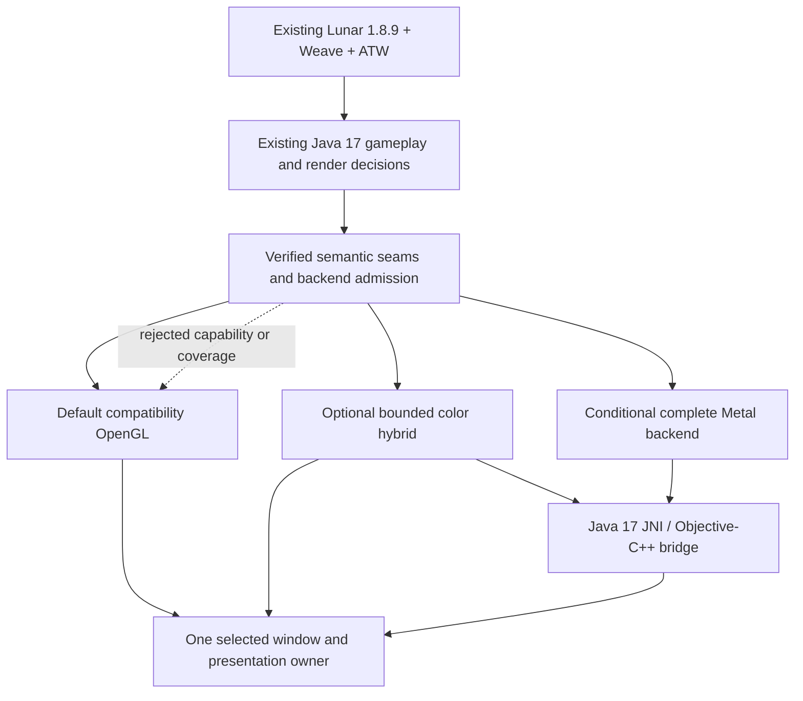

# Apple Silicon / Metal architecture for the existing Lunar + Weave client

Research date: **2026-10-06**. Target: the current **Lunar Client Minecraft 1.8.9 + Weave 1.4.1 + Java 17 + ATW features**, on regular M-series MacBook Air and Pro models. Lunar with Weave is mandatory. A separate client, modern Minecraft, Fabric migration, reduced visual quality, or disabled current features does not satisfy this brief.

**Research only.** This report used official documentation, upstream source, and read-only repository inspection. No implementation, compilation, tests, native-library loading, game execution, profiling, or hardware measurements were performed. Subsequent implementation and live qualification require the user's later approval. **Documented fact**, **repository record**, and **inference/proposal** are distinguished below. No FPS target or improvement is promised.

## Recommendation

**Proposal:** pursue a compatibility-first architecture *inside the existing Lunar + Weave process*: retain its OpenGL renderer as the default and recovery backend; investigate crowd-related CPU preparation and submission costs first; expose only proven rendering seams through a Java-17-compatible JNI bridge. Investigate a bounded Metal color/HUD experiment before considering ownership of the entire world renderer. A full Metal backend is conditional on exact Lunar/OptiFine/ATW coverage, including depth-dependent overlays. If those seams cannot be established, retaining OpenGL is the correct outcome under this brief. The existing audit already documents transformed Lunar fonts, Regions, and opaque matrix bridges rather than a vanilla-only renderer. [Existing renderer constraints][local-constraints], [ATW audit][local-audit]

**Finding:** Apple officially demonstrates OpenGL/Metal **color-texture** interoperability. That establishes a possible incremental migration mechanism, not automatic compatibility with Lunar's drawing or a shared world depth/stencil solution. mcopt explicitly warns that mods drawing directly with OpenGL cannot draw on its Metal backend. The current ATW overlay does call OpenGL and depends on depth/stencil and the normal player-render sequence. [Apple interop sample][apple-interop], [Pinned mcopt README][mcopt-readme], [Current overlay renderer][local-chams]

The following is a **proposed ownership structure**, not an implemented interface. Backend admission happens before rendering; it does not distribute arbitrary legacy draws between APIs.

## 1. Compatibility contract and evidence boundary

**Repository records:** the pinned configuration is Minecraft 1.8.9, Weave 1.4.1 and Java 17; mods use the older Minecraft/LWJGL interfaces. Weave can transform classes but does not supply a replacement-renderer compatibility contract. Compilation against remapped vanilla classes does not prove the semantics of Lunar's transformed implementation. Existing Windows captures cannot establish the exact Mac classes, libraries, OpenGL profile, or performance. [Root instructions][local-agents], [MODS.md][local-mods], [Weave constraints][local-constraints]

The retained visual contract includes normal visible players; the single full normal skin/armor/held-item render wrapped by textured-chams polygon offset; the separate base-model hidden/invisible silhouettes and stencil masks; team colors; Optimal Zone and hit feedback; projectile trajectories; minimap terrain and heads; LevelHead/name labels; Lunar HUD and current resource-pack/font behavior. Multiple intentional base-model stencil passes must not be confused with duplicating the full player render. LevelHead remains the sole packet/chat bridge. [Overlay instructions][local-overlay-agents], [Overlay README][local-overlay-readme], [OccludedPlayerRenderer][local-chams]

**Unknown requiring later evidence:** the exact Mac Lunar 1.8.9 artifact, Java distribution/architecture, all loaded native libraries, Mac-specific transformed render methods, and compatibility of every currently installed feature. This research establishes neither a qualified arm64 Lunar+Weave configuration nor a working Metal injection point. Native Java availability alone cannot establish either.

## 2. Legacy OpenGL and native arm64 Java

### OpenGL remains a compatibility route, with important profile limits

**Documented facts:** Apple deprecated OpenGL in macOS 10.14. Apple's Apple Silicon introduction explicitly retained OpenGL for compatibility, with support up to 4.1; current AppKit documentation still marks its GL APIs deprecated. Deprecation is not the same as removal, but these sources do not promise indefinite future availability. [Apple OpenGL guide][apple-gl-deprecation], [Apple Silicon API session][apple-gl], [NSOpenGLContext][apple-gl-context]

**Documented facts:** AppKit distinguishes a legacy pre-3.0 profile from 3.2/4.1 core profiles. GLFW documents that macOS supports only forward-compatible core contexts for OpenGL 3.2 and later. Legacy immediate mode, matrix stacks, display lists and fixed-function rendering belong to the older API contract. **Inference:** requesting a 4.1 core context is not a drop-in upgrade for a 1.8.9 renderer or ATW's GL11 calls. Inspect the actual compatibility context and extension set; do not infer usable legacy features from the maximum GL version. [AppKit profile definitions][apple-gl-profile], [GLFW conformance][glfw-conformance], [OpenGL 2.1 specification][gl21], [ATW GL usage][local-chams]

### Java 17 can be native, but every in-process native dependency must match

**Documented facts:** OpenJDK delivered its macOS/AArch64 port in JDK 17. Apple states that arm64 and x86_64 machine code cannot be mixed within one process. An x86 JVM under Rosetta and an arm64 JNI library are therefore not an interchangeable pair. [JEP 391][jdk-arm], [Apple Rosetta environment][apple-rosetta]

**Upstream-source finding:** the original LWJGL 2 Mac build examined at commit `2df01dd762e20ca0871edb75daf670ccacc89b60` targets i386/x86_64, not arm64. Its Mac window implementation uses Cocoa, NSOpenGL and private native peer structures. LWJGL 3 publishes Mac arm64 artifacts, but that does not replace LWJGL 2's `Display`, input, `GLContext`, capabilities or JNI ABI. **Unknown:** Lunar may supply its own revised natives; this upstream finding must not be presented as proof that its actual Mac bundle is Intel-only. [Pinned LWJGL 2 build][lwjgl2-build], [Pinned native display][lwjgl2-display], [LWJGL 3 arm64 artifacts][lwjgl3-arm], [Repository LWJGL constraints][local-constraints]

**Proposal:** first inventory the actual Lunar Mac process and all native dependencies, including graphics/windowing, audio, compression and ATW input paths. Prefer an established arm64 Java 17 + architecture-matched Lunar dependency set. If Lunar requires an Intel process, retain that compatibility backend; an experimental bridge would also need an x86_64 slice. Do not silently replace its LWJGL implementation, window, input semantics, account handling, or private-home layout. Porting an upstream LWJGL 2 native library would itself be substantial compatibility work, not an approved task here. [Native architecture restriction][apple-rosetta], [Package contract][local-portable]

## 3. Native boundary: Objective-C++ JNI, retaining Java 17

**Documented facts:** Java 17 supports JNI, including C++ native methods, native-library loading and direct-buffer access. Its FFM API was an **incubator** under `jdk.incubator.foreign`; the finalized `java.lang.foreign` API arrived in JDK 22. A Java 25 renderer using that API is not source/binary compatible with the Java 17 baseline. [JNI design][jni-design], [JNI buffer functions][jni-functions], [JEP 412][jdk-ffm17], [JEP 454][jdk-ffm-final]

**Pinned mcopt finding:** at commit `e900f084e54bca07ee0217855b0f99e8156422e4`, `Native.java` imports `java.lang.foreign` and uses downcall handles into a native Objective-C library. Its build uses Java release 25 and an arm64 native deployment target of macOS 15, while its README requires macOS 26. These are different constraints: compiler deployment target does not prove runtime compatibility with all older OS versions. [Native.java][mcopt-native], [Build configuration][mcopt-build], [README][mcopt-readme]

**Proposal:** use a thin `.mm` bridge with an explicitly versioned C/JNI boundary to Cocoa, Core Video, IOSurface and classic Metal APIs. Keep gameplay, Weave callbacks, partial-tick interpolation and Lunar model/layer decisions in their existing Java execution path. Submit compact batches containing validated state, geometry, resource handles, offsets and immutable pose/label data. Avoid one JNI transition per matrix operation, glyph, vertex, or small GL state change; a native backend can otherwise retain the existing CPU bottleneck.

**Ownership proposal:** allocate a bounded native arena or direct-buffer ring; use explicit sizes, alignment, capacity and generation-tagged handles. Do not equate a Java heap object with stable GPU-addressable memory or retain an ordinary JNI array pointer across GPU execution. JNI direct-buffer access must be checked for support/failure, and native storage must outlive all Java and GPU users. Load the bridge through one agreed game classloader to avoid native-library ownership conflicts. [JNI buffer functions][jni-functions], [JNI library/reference ownership][jni-design]

**Threading facts:** `JNIEnv*` is thread-local. A native thread calling Java must attach to the VM and obey reference lifetimes. **Proposal:** keep GPU completion callbacks native-only where possible; enqueue completion records for the Java render thread. Never copy `JNIEnv*`, local references or mutable live entity objects into asynchronous GPU/worker callbacks. Do not synchronously call back into Java while holding native/Cocoa locks. [JNI design][jni-design], [JNI invocation API][jni-invocation]

## 4. Cocoa window ownership and CAMetalLayer

**Documented facts:** Apple restricts NSView creation, destruction, resizing and manipulation to the main thread. GLFW similarly confines initialization, event processing and window/context creation/destruction to the main thread. LWJGL 3's GLFW binding requires `-XstartOnFirstThread` on macOS. These GLFW rules explain a modern window architecture; they are not proof that Lunar's LWJGL 2 launch needs the same flag. The examined LWJGL 2 native source explicitly marshals window creation/destruction and title operations to Cocoa's main thread. [Cocoa threading][apple-threading], [GLFW threading][glfw-intro], [LWJGL GLFW binding][lwjgl3-glfw], [LWJGL 2 window source][lwjgl2-display]

**Proposal:** preserve Lunar's existing window/input/event owner. Discover its real Cocoa view only through a verified Mac integration seam; there is no GLFW window handle merely because a modern reference renderer uses GLFW. Never put a second independent event loop over the same window. Initially prefer offscreen Metal output presented through the existing GL path; attaching CAMetalLayer is a later presentation-ownership change.

For a CAMetalLayer path, perform view/layer installation, removal and size transitions on the Cocoa main thread; render/encode on one designated owner thread. Publish coherent resize generations and pixel dimensions, accounting for Retina backing scale, external monitors, fullscreen, minimize/restore and zero-sized views. Keep command completion from touching Cocoa views. Native worker threads need scoped autorelease pools and explicit Objective-C object ownership. Those are architecture proposals grounded in Apple's view/thread and drawable lifecycle requirements. [Cocoa threading][apple-threading], [CAMetalLayer lifecycle][apple-layer], [Drawable acquisition][apple-nextdrawable]

**Proposal:** define one presenter per backend mode: either Lunar's GL swap or a Metal drawable presentation. Two independently visible GL/Metal layers do not provide correct shared world depth or a guaranteed atomic frame. Treat window replacement, focus, cursor capture, input scaling and shutdown as compatibility requirements, not incidental renderer setup.

## 5. Frames in flight: maximum FPS and low latency are separate objectives

**Documented facts:** CAMetalLayer's drawable pool allows **2 or 3** drawables, default 3. `nextDrawable` may wait and can return nil, including when the pool is exhausted or layer properties are invalid. Acquire drawables late and release them promptly. `displaySyncEnabled` defaults true; disabling it permits quicker presentation with possible tearing. Presentation is not equivalent to a promise that every rendered frame becomes a complete scanout. [Drawable-count property][apple-drawablecount], [nextDrawable][apple-nextdrawable], [Display synchronization][apple-displaysync]

**Documented facts:** Apple's triple-buffering guidance prevents CPU/GPU overwrite conflicts and allows overlap, but warns that excessive queued buffers increase latency. Its command-buffer guidance recommends few submissions per frame without starving the GPU. **Proposal:** expose separately the resource-ring capacity, CPU/GPU frames-in-flight limit, drawable count, and presentation/VSync policy. Do not treat all four as one “triple buffering” switch. [Triple buffering][apple-triple], [Command-buffer guidance][apple-commandbuffers]

| Proposed policy, for later comparison | Benefit sought | Tradeoff / required evidence |
| --- | --- | --- |
| Compatibility default | Preserve Lunar's existing presentation and current FPS cap | No claim of Metal benefit; retain current timing semantics. |
| Bounded low-latency Metal mode | Start with at most two submitted frames; compare a third resource slot separately | Can reduce overlap or stall on drawable acquisition. Observe queue depth and input-to-present timing, not FPS alone. |
| Throughput Metal mode | Permit up to three in-flight frames if measurements justify it | More overlap may raise CPU throughput while producing older displayed state. Keep a finite queue and retain a user-selected cap/VSync policy. |

**Proposal:** release dynamic buffer slots after GPU completion, not after Java submission; track drawable presentation independently where available. Avoid per-draw `waitUntilCompleted`, `glFinish`, synchronous GPU readback, or main-thread waits that depend on a render thread already waiting for Cocoa. Handle nil drawable and completion errors without leaking permits/resources. An off-switch must stop new submissions and recover at a clean backend boundary; an arbitrary halfway-encoded frame cannot safely resume as though no work occurred. [CPU/GPU lifetime guidance][apple-triple], [Metal presentation API][apple-present], [GL flush/finish semantics][gl21]

**Measurement boundary:** a high software FPS count, actual presented-frame cadence, queue age, tail frame time and end-to-end input latency are different metrics. No M-series measurements were taken. A maximum-throughput policy cannot be declared the best Bedwars policy from software FPS alone.

## 6. Unified memory, synchronization and tiled render passes

**Documented facts:** Apple GPUs share system memory with the CPU; `shared` resources allow both processors access, `private` resources restrict access to the GPU, and `memoryless` textures use tile memory. Shared memory still requires completion/order discipline between CPU writes and GPU reads. [Apple GPU storage modes][apple-storage], [Shared-storage synchronization][apple-shared]

**Proposal:** use preallocated shared buffers for changing poses, vertices, glyph commands and per-frame uniforms; consider private resources for long-lived GPU-only data after measurement. Do not allocate/copy/upload a player's entire model and every font atlas each frame. Fence reuse of ring slices until the consuming command buffer completes. Resource reloads, world changes and texture deletion must create new generations and defer destruction of old resources until their last GPU use. Unified memory eliminates neither Java/native marshaling nor cache pressure, lifetime hazards or cross-API synchronization.

**Documented facts:** Apple GPUs use tile-based deferred rendering. Repeatedly splitting work on the same attachments can add stores and loads to system memory. Apple shows parallel render subencoders as a way to retain one logical pass, and cautions that a performance-only depth prepass can duplicate work already avoided by hidden-surface removal. [Tiled architecture][apple-tbdr], [Apple Silicon optimization session][apple-optimize]

**Proposal:** begin with explicit pass descriptors: clear only at the original clear boundaries; load attachments whose prior contents are required; store color/depth/stencil only for subsequent consumers. Keep compatible opaque/cutout work together where original semantics allow; preserve transparency and overlay barriers. Use memoryless MSAA/depth/stencil only if the contents truly die inside that pass. The current hidden-player stencil/depth consumers can prevent such a choice. Do not add a blanket depth prepass or fragment-visibility culling that removes the deliberate hidden-player effect. [Storage lifetime choices][apple-storage], [Current stencil consumers][local-chams]

## 7. Visual parity: entity pose, fonts and safe batching

Everything in this section is a **proposed parity contract**, not an implemented renderer. The original OpenGL pipeline and current overlay source define the required behavior; Metal supplies explicit pipeline, blend and depth state rather than implementing the old fixed-function calls automatically. [OpenGL 2.1 specification][gl21], [Apple migration reference][apple-migration], [Metal depth testing][apple-depth], [Metal blend factors][apple-blend]

| Surface | Required preservation | Candidate optimization, conditional on later evidence |
| --- | --- | --- |
| Player/entity pose and “skinning” | The exact interpolated Lunar model hierarchy, transforms, normal transforms, slim/classic skin choice, hurt tint, animation, armor, enchantment/glint, capes, held items and first-person path. Minecraft's articulated cuboids are not automatically a modern weighted-skeleton workload. | Retain Java pose/layer decisions; reuse static meshes and upload per-part transforms. GPU transform palettes or instancing must preserve per-entity materials and callbacks. Do not invoke full player rendering twice to feed Metal. |
| Hidden/invisible overlay | One normal full render with polygon offset where currently used; separate base-model masks/silhouettes, hidden-fragment depth comparisons, team alpha, outline scale and stencil clear/replace/zero behavior. Visible players remain normal; no box ESP. | Reduce preparation/submission while retaining intentional mask passes. A Metal equivalent must preserve bias, depth writes, per-pixel stencil and ordering against world geometry. [Current implementation][local-chams] |
| Fonts, name labels and HUD | Existing glyph atlases/resource packs, formatting colors, bold/italic, shadow, underline/strike, obfuscated text updates, Unicode fallback, bidirectional layout, widths, scaling, clipping and LevelHead state. | Cache immutable parsing/layout inputs with complete invalidation, or batch already-decided glyph quads. Lunar already has batching/display-list paths: the prior isolated GL11 glyph experiment was not a proved seam. Native macOS fonts must not replace the Minecraft/Lunar font appearance. [Font constraints][local-constraints] |
| World state | Textures/mips/filtering, lightmap texture unit, fog, alpha-test/discard threshold, lighting/color multiplication, culling/winding, clipping, depth range/precision, block damage and resource reloads. | Cache pipeline/state objects keyed by their actual behavior; convert unsupported primitives without changing geometry. Translate projection/texture-coordinate conventions explicitly. Reversed-Z or different color-space behavior is a separate visual change, not an automatic optimization. |
| Transparency and antialiasing | Preserve translucent world/entity/HUD ordering, separate RGB/alpha factors, depth-write policy, alpha rejection and configured AA/filtering. | Merge only compatible **order-preserving** runs. Do not globally sort labels or translucent draws by texture; do not change blended cutouts into opaque geometry. Keep the requested MSAA mode and explicit resolve/store boundaries; reject the Metal mode and retain GL if that configuration cannot be reproduced. [Sample-count query][apple-samples] |

**Submission proposal:** represent a draw by mesh range, material/textures, transform/pose, lightmap, alpha/fog state, blend/depth/stencil state, scissor/viewport, target and original order. Adjacent equivalent draws can share setup; opaque grouping still requires proof about callbacks and intermediate queries. Argument buffers/instancing may reduce native binding calls, but bring residency and lifetime obligations and cannot remove Java model preparation on their own. [Apple argument-buffer rationale][apple-arguments], [Argument-buffer residency][apple-residency]

**Compatibility proposal:** include all known raw OpenGL operations, display-list compilation/replay, resource mutations, framebuffer changes and queried state in the coverage inventory. Updating only driver state while leaving Minecraft/Lunar's cached state inconsistent is unsafe. Keep exceptions, event ordering and all observable model/layer decisions intact. A Metal renderer that silently omits unknown draws fails the feature contract, even if it renders terrain correctly. [Existing state/bridge constraints][local-constraints]

## 8. Hybrid OpenGL + Metal: supported color sharing versus unproved depth sharing

### What the primary evidence establishes

**Apple sample facts:** its documented interop approach uses compatible Core Video/GL/Metal formats and a CVPixelBuffer-backed texture. The Mac sample format table contains BGRA8, sRGB BGRA8, BGR10A2 and RGBA16Float mappings; it does not demonstrate a shared depth/stencil attachment. Its OpenGL renderer samples a rectangle texture, so target/coordinate handling cannot be assumed identical to an ordinary Minecraft GL_TEXTURE_2D atlas. The source is available from the official sample download. [Apple interop article and download][apple-interop], [Official sample archive][apple-interop-zip]

**Other documented API facts:** Metal can create an IOSurface-backed texture; Apple's professional-video API directs callers to `CGLTexImageIOSurface2D` for GL conversion. This is resource creation/aliasing support, not a promise of all formats, multisample surfaces, depth attachments, or a shared GL/Metal command stream. [IOSurface texture creation][apple-iosurface-texture], [CGL conversion guidance][apple-cgl-surface]

**Depth caveat:** do not generalize an old “depth must be private” rule to every modern Apple GPU: current Apple capability tables list nonprivate depth/stencil support. Equally, that entry does **not** establish that Lunar's GL depth/stencil attachment can alias a Metal texture through IOSurface with compatible layout, compression, precision, MSAA and synchronization. No inspected primary source establishes that complete path for this client. Shared color support is not evidence of shared depth. [Current Metal capability tables][apple-capabilities]

### Synchronization is not free, and the Core Video sample matters

**Source fact:** Apple's current `AAPLMetalViewController.m` calls `glFlush()` before Metal consumes the CVPixelBuffer-backed output. Its comments associate that with this managed interop path. **GL specification fact:** `glFlush` requests progress; `glFinish` waits for prior GL effects to complete. Therefore neither “all hybrids need glFinish” nor “glFlush alone makes every raw IOSurface producer/consumer safe” follows. [Official sample archive][apple-interop-zip], [OpenGL flush/finish specification][gl21]

**Proposal:** distinguish a documented Core Video cache path from a manually created CGL/IOSurface/Metal path. Identify its actual GL-to-Metal and Metal-to-GL ordering guarantees and slot-reuse ownership. Do not assume GL fences and Metal events are interchangeable. A conservative explicit completion wait may be necessary for a custom path until proved otherwise, but serializing the APIs can erase throughput gains. IOSurface locking is not a substitute for proving GPU producer completion. **Unknown:** the achievable synchronization cost in Lunar on the target Mac range.

### Architecture choices under the Lunar constraint

| Proposed hybrid | Depth/visual consequence | Assessment |
| --- | --- | --- |
| Entire existing GL frame to shared color, Metal presents | World, entities and overlays retain one GL depth/stencil owner. Extra color target/composition, scheduling and synchronization remain. | Strongest initial visual coverage, but mainly changes presentation; it does not eliminate GL draw dispatch or Java entity work. No speedup assumption. |
| Metal renders a bounded 2D surface; GL composites it | No shared world depth required if the surface truly has no world-depth dependency. Exact alpha, ordering, clipping, coordinates and color space still matter. | Plausible narrow seam if ATW/Lunar exposes compatible final glyph/HUD geometry. Keep other features in GL. |
| Metal world/entities plus GL 2D HUD | A HUD can use shared color after the world completes, **only** if world labels, player overlays, held items and every depth-dependent path also have correct ownership. | Illustrative transition shape; does not qualify the current ATW world overlays. MetalMC is a modern reference being researched separately, not proof of Lunar integration. [MetalMC project][metalmc] |
| Metal terrain, GL players/chams/names | World depth is needed for players, labels, silhouettes and stencil. Color composition alone cannot restore occlusion. | Reject as a default stage. It needs proved depth/stencil interchange or an explicit equivalent reconstruction with measured costs and exact coverage. |

**Inference:** exporting depth into a color texture and reconstructing another API's depth may be possible for a controlled renderer, but adds geometry/pass work or copies, conversions, bandwidth and synchronization. Packed stencil and multisample depth are separate problems. A linear single-sample depth copy can lose the sample information required for original edges and bias decisions. This is an investigation hypothesis, not a supported zero-copy shared-depth solution.

**Cost proposal:** account for every offscreen attachment, resolve, full-surface read/write, ownership transfer and resource ring. Do not call IOSurface “free” because CPU readback is absent. Each retained full-resolution RGBA8 color image costs `width × height × 4` bytes before padding; multiple rings plus GL/Metal depth and MSAA resources multiply that footprint. Retain buffers until all producers/consumers finish, without adding an unbounded older-frame queue. Apple documents tile-memory benefits precisely because unnecessary external-memory traffic has costs. [Tiled GPU guidance][apple-tbdr], [Drawable/ring lifetime][apple-triple]

## 9. Direct Metal, translation libraries and full replacement

| Route | Documented boundary | Recommendation under mandatory Lunar + Weave |
| --- | --- | --- |
| Direct Metal backend via JNI | Explicit geometry, shaders, resources and render state; no automatic old-GL behavior. [Apple migration][apple-migration] | Best control if exact Lunar seams exist; initially bounded and default-OFF. Preserve a GL backend. |
| ANGLE over Metal | ANGLE implements OpenGL **ES/EGL** over backends including Metal; its current README also describes ES 1.1 support. It is not desktop GL's whole compatibility API. [ANGLE official README][angle] | Not a replacement `libGL` for LWJGL 2. Requires adaptation of context creation, API calls, legacy/display-list semantics and shaders plus Lunar compatibility. ES fixed-function support does not make desktop GL1/2 calls equivalent. |
| Vulkan through MoltenVK | MoltenVK implements a Vulkan portability subset over Metal. [MoltenVK official project][moltenvk] | Requires a Vulkan renderer or an additional GL translation layer; it does not automatically translate existing GL11 calls. A Vulkan rewrite still owns the same feature-parity problem. |
| Full desktop-GL translation shim | Would need the actual legacy/extension API surface, state, queries, display lists, buffers, render targets and synchronization used by Lunar and mods. [Legacy API specification][gl21] | A separate graphics compatibility project inside Lunar, not a quick library switch. Only investigate if semantic seams cannot cover the client and the user later accepts the scope. |
| Full renderer replacement **inside Lunar** | Would have to own world, entities/layers, labels/HUD, particles, weather, items, GUI and every current overlay, or use explicit interoperable seams. [Repository constraints][local-constraints] | Conditional final stage, not a standalone-client recommendation. Unknown raw-GL consumers must cause GL fallback rather than disappearing. |

**Modern-reference boundary:** mcopt's pinned README targets Minecraft 26.3/Fabric/Sodium and Java 25, with macOS 26 required. Its compatible backend abstractions are inspiration, not 1.8.9 Weave hooks. Neither its published FPS figures nor modern world-generation/LOD work establishes a Bedwars improvement here; those figures are not reproduced in this report. [mcopt README][mcopt-readme]

## 10. Bedwars priorities: crowd CPU limits before distant terrain

**Repository evidence:** existing ATW research identifies name preparation, font bridging, event/draw dispatch and already-present Lunar batching as candidates. It also warns that inclusive timings, sampling counts and lobby armor-stand populations cannot establish the removable cost of player rendering. No M-series bottleneck measurements exist in this report. [ATW audit][local-audit], [Upstream optimization survey][local-upstream]

**Proposed priority order:**

1. **Crowd and label preparation:** distinguish real players, armor stands/NPC labels, pose/layer computation, component/style conversion, glyph preparation and allocation. Preserve name output and mutable-state/event semantics. A Metal backend cannot accelerate Java work that remains dominant.
2. **Java/native draw dispatch and state setup:** count actual submissions and repeats after accounting for Lunar's existing batching. Use compatible-run batching and retained geometry where later attribution supports it. One native call per existing tiny command is not the architectural objective.
3. **Actual GPU work:** only after separating submission from execution, assess resolution/MSAA, skins/armor/glint, translucent overdraw, overlay passes and upload bandwidth. Optimize the same content; do not conceal gains by disabling chams, names, particles, minimap, terrain or quality.
4. **Chunk visibility/meshing/streaming:** retain a secondary investigation for moving scenes with demonstrated cost. Existing Regions paths must be understood before adding a new terrain batcher. Prioritize neither far-distance LOD nor single-player world generation without Bedwars evidence. [Existing terrain/Regions findings][local-upstream]

**System-boundary inference:** replacing client rendering does not change the remote server's TPS, authoritative simulation or WAN round-trip delay. It may alter local input processing/presentation time; it cannot promise faster server confirmation or network delivery. Client chunk decoding/meshing is distinct from the server generating the map. This follows from separating the local renderer from remote computation; it is not a measured network claim.

**Air/Pro proposal:** use runtime memory/feature limits and bounded caches rather than a minimum “10 GPU cores” rule imported from mcopt's experimental LOD. Compare sustained behavior as well as short bursts in any later approved qualification: memory pressure, power policy, native architecture, resolution, refresh rate and thermal state can change the limiting component. No exact chip is assumed and no model-specific gain is claimed.

## 11. OS and Metal feature floor: a design decision, not mcopt's floor

**Documented facts:** Apple identifies M1 with GPU family Apple7 and later M-series with later families. Classic MTL command queues/buffers, IOSurface texture creation and presentation predate Apple Silicon; drawable-count and display-sync controls also predate it. Metal 4 was introduced on macOS 26. These facts do not make macOS 26 a requirement for every Metal renderer. [GPU family definitions][apple-families], [IOSurface API availability][apple-iosurface-texture], [Presentation availability][apple-present], [Drawable-count availability][apple-drawablecount], [Display-sync availability][apple-displaysync], [macOS 26 release notes][apple-os26]

**Proposed architecture floor:** design the initial bridge around **macOS 11 / M1 (Apple7-class features) / native Java 17**, using classic Metal render-pipeline/depth-stencil objects, command queues/buffers, ordinary indexed/instanced draws, shared-buffer rings and optional Core Video color interoperability. This is a technical target, **not a verified support commitment**: the shipped floor is the maximum of Lunar's actual Mac support, Java distribution requirements, all native dependencies, shaders, and selected APIs. A later approval can deliberately narrow it for maintenance reasons, but must label that as a product decision.

**Proposal:** do not initially require Metal 4 command allocators/argument tables, newer residency APIs, hardware ray tracing, frame interpolation, mesh shaders, variable-rate rendering, or Apple8+ features. Query GPU family, sample counts, relevant pixel formats and individual optional APIs at runtime; an OS version or “Metal capable” label is insufficient. A higher-tier optimization must leave the base backend complete. [Capability tables][apple-capabilities], [GPU-family queries][apple-families], [MSAA query][apple-samples]

**mcopt distinction:** its native build target of macOS 15 and README requirement of macOS 26 are neither a Metal minimum nor proof that its binary can run on 15. Do not inherit those requirements—or Java 25—without a specific required API and a deliberate decision. [Pinned build][mcopt-build], [Pinned requirements][mcopt-readme]

## 12. Staged architecture and later approval gates

All stages below are **proposals only**. No gate was executed as part of this research.

| Stage | Architecture / retained behavior | Evidence needed before proceeding |
| --- | --- | --- |
| 0. Exact Mac baseline | Current Lunar+Weave+ATW OpenGL path; current settings and all visuals. | Identify real Java/native architectures, LWJGL/window owner, transformed classes, context/profile/extensions, OptiFine/Lunar render paths, native input support and every feature. Separate read-only inventory from any later launch/profile requiring approval. |
| 1. CPU work within the existing renderer | Independently switchable bounded preparation/submission improvements; original GL drawing retained. | Demonstrate relevant crowd costs and immutable reuse/batching seams; retain callbacks, ordering, resource invalidation, exception behavior and original fallback. Existing Windows results are not Mac qualification. |
| 2. Java 17 JNI offscreen seam | Versioned bridge and bounded Metal resource ownership; existing Lunar window/presenter remains. | Architecture-matched library loading; exact ABI/resource lifecycle; an owned 2D/color operation with output parity and no hidden world-depth dependency. |
| 3. Qualified color hybrid | One bounded surface or entire completed GL color frame exchanged using a documented path. | Correct format/target/orientation/alpha/color space and resize lifecycle; proved producer/consumer ordering and bounded reuse; net frame-time and presentation benefit with all features. Added composition cost may invalidate this stage. |
| 4. Depth-dependent migration, only if justified | Migrate a coherent set of world/entity/overlay passes to one depth/stencil owner, or establish exact interop. | Coverage of all occlusion/stencil/MSAA/transparency consumers. Reject terrain-only migration while player/chams depth correctness is unresolved. |
| 5. Optional full Metal backend within Lunar | Semantic adapters cover the entire required renderer; GL remains available. | Exact transformed-runtime admission and visual parity; resource reloads and arbitrary direct-GL consumers accounted for; sustained Air/Pro evidence; user approval of the larger scope. No separate-client substitution. |

**Backend proposal:** define compatibility GL, experimental color hybrid, and optional full Metal as explicit modes. Select a mode at startup or a controlled renderer lifecycle boundary. Keep existing CPU improvements independently reversible. Default to GL until qualification; a global off-switch must be usable before native/window initialization. On unsupported runtime fingerprints, missing bridge, failed capabilities, unhandled draw paths or resource errors, fail admission and retain the original client renderer. Runtime recovery must occur on a clean frame/reload boundary, with in-flight resources accounted for; some failures may require a restart rather than a seamless switch.

**Configuration proposal:** later settings belong in `Config` with persisted keys, safe defaults and a complete launcher/mod/native handshake, as root instructions require. Candidate concepts are backend choice, Metal enablement, in-flight limit and presentation policy; these are not implemented keys. Preserve current `maxFps`, executable-local settings, private home, account isolation and mod paths. No settings, packaged jars or runtime copies were changed. [Config policy][local-agents], [Portable contract][local-portable]

**Later qualification evidence:** same client/features/resource packs/settings and crowd classes; native CPU preparation/submission versus GPU execution; completed/presented frame distributions and queue depth; allocation/upload/synchronization costs; and visual parity across player layers, fonts, chams, transparency, MSAA, reload/resize/minimize/fullscreen. Include measured overhead of any instrumentation. Hardware/game execution and all such experiments remain outside this report's authorization.

## 13. Unresolved decisions and source provenance

- There is no inspected, documented Lunar Mac renderer extension API establishing replacement compatibility. Weave transformation capability is not enough to resolve this.
- Exact Mac arm64 Lunar 1.8.9+Weave native compatibility remains unverified; LWJGL 2 upstream history cannot decide what Lunar currently packages.
- The primary evidence supports managed color interoperability. It does not qualify GL/Metal depth/stencil sharing, multisample parity, or the cost of a custom IOSurface handoff for this client.
- No MacBook-specific bottleneck attribution, FPS result or input-latency measurement was obtained. Full Metal can remain out of reach under the required compatibility contract.
- The proposed macOS 11/Apple7 floor depends on future dependency/API inventory; it must not be advertised as supported yet.

Source copies are private audit material at `upgrade-work/mac-metal-research-20261006/apple-audit/`, with URLs and SHA-256 values in `apple-source-manifest.json`. Apple documentation JSON was read when a web page required JavaScript; sample source was read directly from Apple's archive without building or executing it. OpenJDK JEP pages were fetched read-only after the web fetcher returned 403. GitHub source links pin the inspected commits; Apple/GLFW documentation and project main pages are live documents as observed on the research date. The report's claims use the public primary links below, not private copies as the sole authority.

[local-agents]: ../../AGENTS.md
[local-mods]: ../../MODS.md
[local-portable]: ../PORTABLE.md
[local-constraints]: WEAVE_RENDER_CONSTRAINTS.md
[local-audit]: ATW_RENDER_AUDIT.md
[local-upstream]: UPSTREAM_RENDER_OPTIMIZATIONS.md
[local-overlay-agents]: ../../weave-mods/optimal-zone/AGENTS.md
[local-overlay-readme]: ../../weave-mods/optimal-zone/README.md
[local-chams]: ../../weave-mods/optimal-zone/src/main/java/com/atw/optimalzone/render/OccludedPlayerRenderer.java
[apple-gl-deprecation]: https://developer.apple.com/library/archive/documentation/GraphicsImaging/Conceptual/OpenGL-MacProgGuide/opengl_designstrategies/opengl_designstrategies.html
[apple-gl]: https://developer.apple.com/videos/play/wwdc2020/10631/
[apple-gl-context]: https://developer.apple.com/documentation/appkit/nsopenglcontext
[apple-gl-profile]: https://developer.apple.com/documentation/appkit/nsopenglprofileversion4_1core
[glfw-conformance]: https://www.glfw.org/docs/latest/compat_guide.html
[glfw-intro]: https://www.glfw.org/docs/latest/intro_guide.html#thread_safety
[gl21]: https://registry.khronos.org/OpenGL/specs/gl/glspec21.pdf
[jdk-arm]: https://openjdk.org/jeps/391
[jdk-ffm17]: https://openjdk.org/jeps/412
[jdk-ffm-final]: https://openjdk.org/jeps/454
[apple-rosetta]: https://developer.apple.com/documentation/apple-silicon/about-the-rosetta-translation-environment
[lwjgl2-build]: https://github.com/LWJGL/lwjgl/blob/2df01dd762e20ca0871edb75daf670ccacc89b60/platform_build/macosx_ant/build.xml
[lwjgl2-display]: https://github.com/LWJGL/lwjgl/blob/2df01dd762e20ca0871edb75daf670ccacc89b60/src/native/macosx/org_lwjgl_opengl_Display.m
[lwjgl3-arm]: https://www.lwjgl.org/browse/release/latest/macosx/arm64
[lwjgl3-glfw]: https://javadoc.lwjgl.org/org/lwjgl/glfw/package-summary.html
[jni-design]: https://docs.oracle.com/en/java/javase/17/docs/specs/jni/design.html
[jni-functions]: https://docs.oracle.com/en/java/javase/17/docs/specs/jni/functions.html#nio-support
[jni-invocation]: https://docs.oracle.com/en/java/javase/17/docs/specs/jni/invocation.html#attaching-to-the-vm
[mcopt-readme]: https://github.com/noahdunnagan/mcopt/blob/e900f084e54bca07ee0217855b0f99e8156422e4/README.md
[mcopt-native]: https://github.com/noahdunnagan/mcopt/blob/e900f084e54bca07ee0217855b0f99e8156422e4/metal/src/main/java/mcopt/metal/Native.java
[mcopt-build]: https://github.com/noahdunnagan/mcopt/blob/e900f084e54bca07ee0217855b0f99e8156422e4/metal/build.gradle
[apple-threading]: https://developer.apple.com/library/archive/documentation/Cocoa/Conceptual/Multithreading/ThreadSafetySummary/ThreadSafetySummary.html
[apple-layer]: https://developer.apple.com/documentation/quartzcore/cametallayer
[apple-nextdrawable]: https://developer.apple.com/documentation/quartzcore/cametallayer/1478172-nextdrawable
[apple-drawablecount]: https://developer.apple.com/documentation/quartzcore/cametallayer/maximumdrawablecount
[apple-displaysync]: https://developer.apple.com/documentation/quartzcore/cametallayer/displaysyncenabled
[apple-triple]: https://developer.apple.com/library/archive/documentation/3DDrawing/Conceptual/MTLBestPracticesGuide/TripleBuffering.html
[apple-commandbuffers]: https://developer.apple.com/library/archive/documentation/3DDrawing/Conceptual/MTLBestPracticesGuide/CommandBuffers.html
[apple-present]: https://developer.apple.com/documentation/metal/mtlcommandbuffer/present(_:)
[apple-storage]: https://developer.apple.com/documentation/metal/choosing-a-resource-storage-mode-for-apple-gpus
[apple-shared]: https://developer.apple.com/documentation/metal/mtlstoragemode/shared
[apple-tbdr]: https://developer.apple.com/documentation/metal/tailor-your-apps-for-apple-gpus-and-tile-based-deferred-rendering
[apple-optimize]: https://developer.apple.com/videos/play/wwdc2020/10632/
[apple-migration]: https://developer.apple.com/documentation/metal/migrating-opengl-code-to-metal
[apple-depth]: https://developer.apple.com/documentation/metal/calculating-primitive-visibility-using-depth-testing
[apple-blend]: https://developer.apple.com/documentation/metal/mtlblendfactor
[apple-samples]: https://developer.apple.com/documentation/metal/mtldevice/supportstexturesamplecount(_:)
[apple-arguments]: https://developer.apple.com/documentation/metal/managing-groups-of-resources-with-argument-buffers
[apple-residency]: https://developer.apple.com/documentation/metal/tracking-the-resource-residency-of-argument-buffers
[apple-interop]: https://developer.apple.com/documentation/metal/mixing-metal-and-opengl-rendering-in-a-view
[apple-interop-zip]: https://docs-assets.developer.apple.com/published/84862c7e7ce1/MixingMetalAndOpenGLRenderingInAView.zip
[apple-iosurface-texture]: https://developer.apple.com/documentation/metal/mtldevice/maketexture(descriptor:iosurface:plane:)
[apple-cgl-surface]: https://developer.apple.com/documentation/professional_video_applications/fximagetile/opengltexture(forcontext:)
[apple-capabilities]: https://developer.apple.com/metal/capabilities/
[apple-families]: https://developer.apple.com/documentation/metal/mtlgpufamily
[apple-os26]: https://developer.apple.com/documentation/macos-release-notes/macos-26-release-notes
[angle]: https://chromium.googlesource.com/angle/angle/+/main/README.md
[moltenvk]: https://github.com/KhronosGroup/MoltenVK
[metalmc]: https://github.com/XaviFortes/MetalMC
